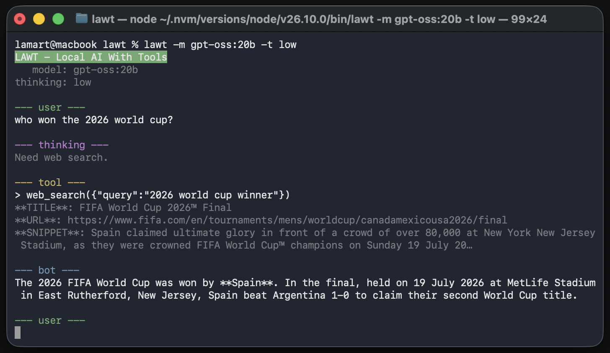

# LAWT

[](https://github.com/lamartinecabral/lawt/actions/workflows/test.yml)
[](./LICENSE)

**Local AI With Tools** is a small terminal assistant for OpenAI-compatible chat models. It can search and edit files in your current workspace, run shell commands, and look up web pages.

Requires Node.js 24 or newer. The default provider is [Llama](https://llama.app), which should be running locally. LAWT also supports other OpenAI-compatible providers.

`lawt` is intentionally a minimal implementation: the code should be easy for anyone to understand, own, and adapt to their own workflow. Its small surface area also keeps the context sent to local models clean and lightweight, leaving more room for the task at hand.



## Quick start

```bash
npm install
npm run install:lawt
lawt list                 # show models available from the provider
lawt --model <model-id>   # start an interactive session
```

Install a model in Llama before starting `lawt`. The app serves the model through its local API; no provider configuration is needed. See the [Llama setup guide](./docs/llama.md) for details.

Enter a request at the prompt, for example `Summarize the files in this project`. Use `lawt --exec "<task>"` to run a single task and exit. Run `lawt --help` for command-line options.

In an interactive session, model responses appear as they are generated. Enter a multi-line prompt by typing `"""` on a line by itself, then close it with another `"""` line. Press Escape to cancel a response. Use `/exit` or `/quit` to leave, `/model` to list models, and `/export` to save the conversation as JSON.

See [PROJECT.md](./PROJECT.md) for project details, [docs/llama.md](./docs/llama.md) for the default provider setup, and [docs/ollama.md](./docs/ollama.md) for Ollama setup tips. To connect a different provider or configure web search, see the provider section in [PROJECT.md](./PROJECT.md).
