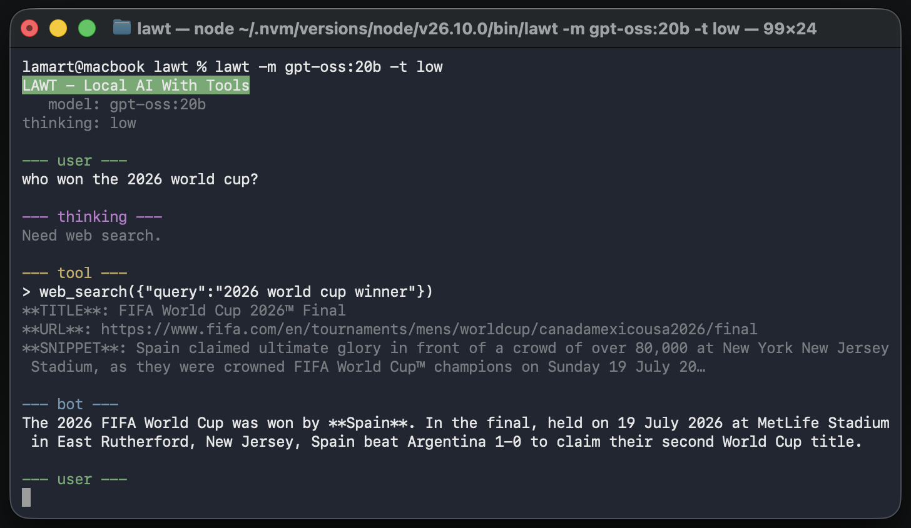

# LAWT

[](https://github.com/lamartinecabral/lawt/actions/workflows/test.yml)
[](./LICENSE)

**Local AI With Tools** is a small terminal assistant for OpenAI-compatible chat models. It can search and edit files in your current workspace, run shell commands, and look up web pages.

Requires Node.js 24 or newer and an OpenAI-compatible provider. Ollama is the default provider and should be running locally.

`lawt` is intentionally a minimal implementation: the code should be easy for anyone to understand, own, and adapt to their own workflow. Its small surface area also keeps the context sent to local models clean and lightweight, leaving more room for the task at hand.



## Quick start

```bash
npm install
npm run install:lawt
lawt list                 # show models available from the provider
lawt --model <model-id>   # start an interactive session
```

For example, with Ollama:

```bash
ollama pull <model-id>
lawt --model <model-id>
```

Enter a request at the prompt, for example `Summarize the files in this project`. Use `lawt --exec "<task>"` to run a single task and exit. Run `lawt --help` for command-line options.

In an interactive session, use `/exit` or `/quit` to leave, `/model` to list models, `/stream` to toggle streamed output, and `/export` to save the conversation as JSON. Start a multi-line prompt by entering `"""` on a line, and finish it with another `"""` line. Press Escape to cancel a response.

See [PROJECT.md](./PROJECT.md) for project details and [docs/ollama.md](./docs/ollama.md) for Ollama setup tips. To connect a different provider or configure web search, see the provider section in [PROJECT.md](./PROJECT.md).
